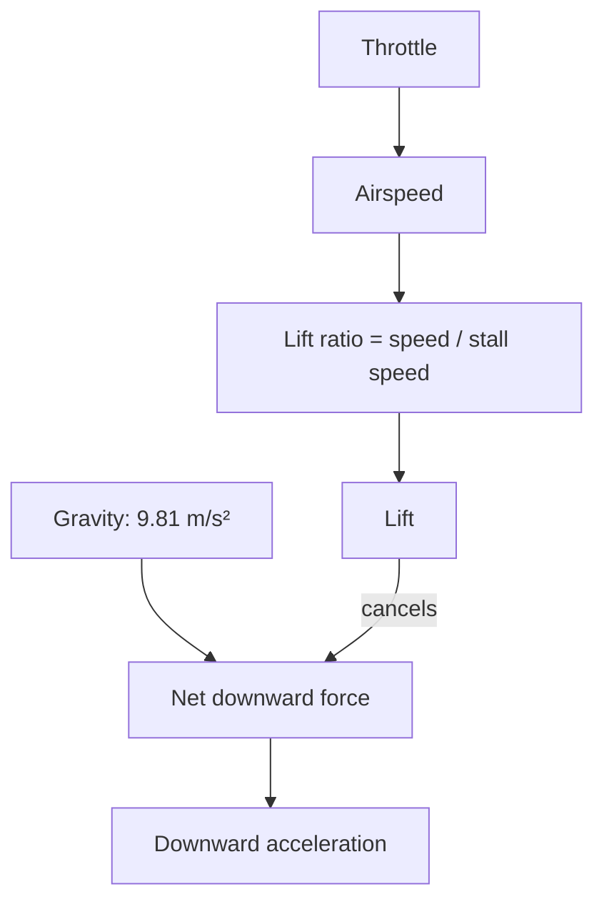

# Flight Physics and Controls

## 1. Overview

The flight model is arcade-leaning but has some aerodynamics in it:

* full 6-DOF rotation (pitch, roll, yaw),
* lift that depends on airspeed and fights gravity,
* stalls below a threshold speed,
* AZERTY/QWERTY detection for keyboard defaults.

The code is in [`spaceship_controller.gd`](../godot_project/spaceship_controller.gd),
and input setup is in [`config_manager.gd`](../godot_project/config_manager.gd).

---

## 2. Lift and Gravity

In atmosphere the ship is pulled down by gravity, and wing lift cancels it
out in proportion to airspeed.

### Lift

$$\text{Lift Ratio} = \text{clamp}\left(\frac{\text{Current Airspeed}}{\text{Stall Airspeed}}, 0.0, 1.0\right)$$

$$\text{Downwards Acceleration} = (1.0 - \text{Lift Ratio}) \cdot g$$

### Flight envelope

Defaults are the exported values on `SpaceshipController`. Missions can
override `stall_speed_ms` in the campaign manifest.

| Regime | Speed | Lift ratio | Behaviour |
| :--- | :--- | :--- | :--- |
| Cruise | 60 m/s (216 km/h) | 1.0 | Level flight, gravity fully cancelled. |
| Afterburner | 120 m/s (432 km/h) | 1.0 | Combat speed. |
| Stall | < 25 m/s (< 90 km/h) | < 1.0 | Stall warning and horn, reduced control authority, nose drops. |
| Idle | 0 m/s | 0.0 | Free fall, terminal velocity capped at 60 m/s. |

Since 0.9.6 the model also tracks G-load, adds induced drag above about 3 G,
trades speed for altitude on climbs and dives, and lets parasitic drag pull
speed back toward cruise.

---

## 3. Keyboard Layouts

On AZERTY keyboards (Belgian, French), W and Z swap places and so do A and Q,
so QWERTY's WASD defaults land in the wrong spots. The game picks its defaults
by layout:

1. **Windows:** reads the user locale and the keyboard preload list from the
   registry and selects AZERTY if it finds `080C` (Belgian French), `0813`
   (Belgian Dutch) or `040C` (French).
2. **Other platforms / fallback:** `DisplayServer.keyboard_get_layout_name()`
   and `OS.get_locale()`.
3. **Manual:** press **F1** at any time to switch. Settings also has AZERTY
   and QWERTY presets, and every action can be rebound.

Bindings use logical keycodes, so a rebind matches the key label you press.

### Default bindings

| Action | QWERTY | AZERTY |
| :--- | :--- | :--- |
| Pitch up / down | ↑ / ↓ | ↑ / ↓ |
| Roll left / right | A / D | Q / D |
| Yaw left / right | ← / → | ← / → |
| Throttle up / down | W / S | Z / S |
| Afterburner | Shift | Shift |
| Gun | F, left mouse | F, left mouse |
| Missile | Space, Enter, right mouse | Space, Enter, right mouse |
| Radar | R | R |
| Pause / release mouse | Esc | Esc |
| Switch layout | F1 | F1 |
| Switch split orientation (co-op) | F2 | F2 |
| Phone controller QR | F3 | F3 |

Mouse movement also steers (pitch and yaw), with adjustable sensitivity and
optional pitch inversion.

---

## 4. Gamepad

Xbox button names are shown. Godot maps PlayStation and other controllers to
the same positions.

| Action | Binding |
| :--- | :--- |
| Pitch / roll | Left stick |
| Yaw | Right stick X, or LB / RB |
| Throttle up / down | RT / LT |
| Afterburner | L3 or Y |
| Gun | A or R3 |
| Missile | B |
| Radar | X |
| Back / cancel in menus | B |

---

## 5. Split-Screen and Co-op Input

### Two controllers
- Controller 1 (`device 0`) drives player 1.
- Controller 2 (`device 1`) drives player 2.

### One keyboard
Player 2 uses the right-hand cluster or the numpad:

| Action | Player 2 keys |
| :--- | :--- |
| Pitch up / down | K / I, or Numpad 2 |
| Roll left / right | J / L, or Numpad 4 / 6 |
| Yaw left / right | U / O, or Numpad 7 / 9 |
| Throttle up / down | Y / H, or Numpad 8 / 5 |
| Afterburner | N or Numpad 0 |
| Gun | Enter or Numpad Enter |
| Missile | M or Numpad . |
| Radar | P |

### Drop-in join
In the campaign, pressing any player 2 control (keyboard cluster or a second
gamepad) adds player 2 as a wingman and splits the screen.

---

## 6. Phone Controller

The web controller at `/controller` sends input to the game over the LAN (see
[ZERO_COST_INFRASTRUCTURE_AND_CONTROLLER_SPEC.md](ZERO_COST_INFRASTRUCTURE_AND_CONTROLLER_SPEC.md)).

### Touch layout
* **Stick (left thumb):** analog pitch and roll, with a 4% deadzone and an
  exponential response curve.
* **Throttle slider (right thumb):** 0–100%, with afterburner at the top.
* **Fire buttons:** gun (with a vibration pulse) and missile.

### Gyro steering
When gyro steering is on, `DeviceOrientationEvent` angles are rotated into
screen space, so landscape orientation works, and mapped to pitch and roll.
**Tare Horizon** zeroes the current hold angle.

---

## 7. Chase Camera

$$\vec{P}_{\text{target}} = \vec{P}_{\text{ship}} + (\hat{Z}_{\text{local}} \cdot D) + (\hat{Y}_{\text{local}} \cdot H)$$

with $D = 14$ m and $H = 4$ m (`camera_distance`, `camera_height`).

* The camera looks at a point 8 m ahead of the nose.
* Its up vector is smoothed toward the ship's local up, so it leans into banks.
* In split-screen, each player's camera lives in its own `SubViewport`.
