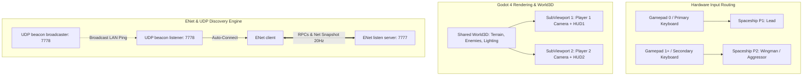
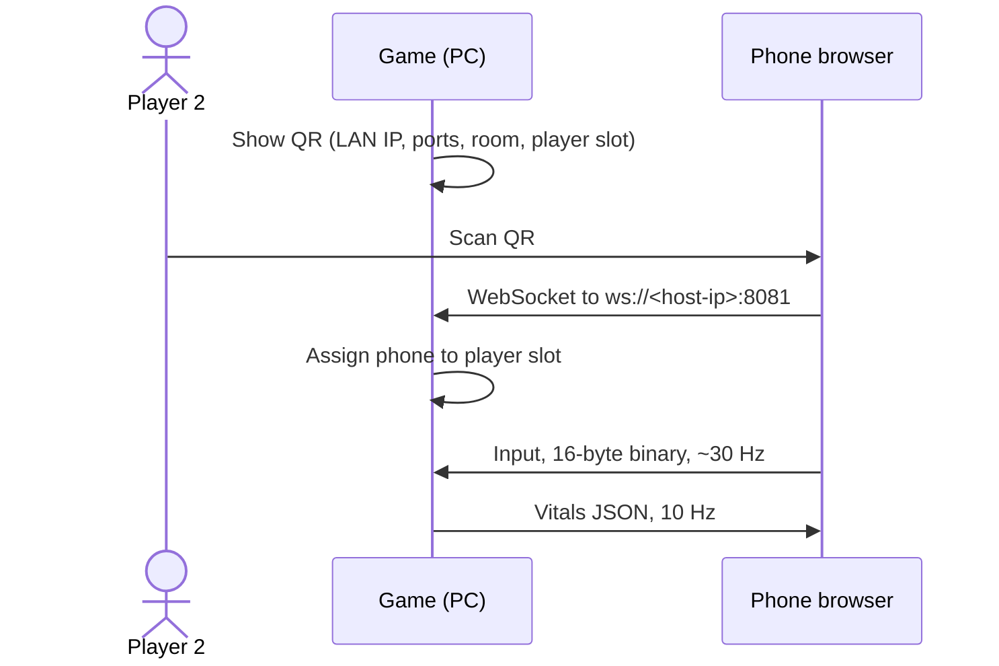

# Multiplayer, Split-Screen and Co-op

The game has four multiplayer modes:

1. **Campaign co-op:** a second player can join any campaign mission at any
   time, on a split screen.
2. **Split-screen arena:** local 1v1 on one PC, first to 5 kills.
3. **LAN arena:** ENet over the local network, found with UDP broadcast
   beacons.
4. **Internet lobbies:** the same ENet game over the internet, with lobbies
   listed through the website API (see Section 5).

---

## 2. System Architecture



---

## 3. Campaign Drop-In Split-Screen Co-Op

### Joining
Campaign sorties (`main.tscn` / `main.gd`) start full-screen. The screen splits when player 2 presses one of their controls:
* **Gamepad Input**: Any button or thumbstick deflection ($> 0.6$) on `device >= 1`.
* **Secondary Keyboard Cluster**: `I`, `J`, `K`, `L`, `U`, `O`, `Y`, `H`, `N`, `M`, `P`, `Enter`, `NumPad Enter`, or NumPad directional keys (`8`, `2`, `4`, `6`, `5`, `7`, `9`, `0`).
* **Configured Actions**: Any event mapped to `P2_ACTIONS` in [`config_manager.gd`](../godot_project/config_manager.gd).

### What happens on join
1. `join_player_2()` instantiates `SpaceshipP2` with `player_id = 2`, `is_split_screen = true`, and `pvp_mode = false`.
2. A runtime `CoopSplitLayer` (`CanvasLayer` on `layer = 1`) is created with two `SubViewportContainer`s.
3. Both `SubViewport`s use `sub_viewport.world_3d = get_world_3d()`, so both players fly in the same world and nothing is duplicated.
4. Each viewport gets its own `Camera3D` and `TacticalOverlay` HUD. The full-screen HUD is hidden.
5. A radio message announces the wingman.

### Spawn position and colours
* Player 2 spawns at `ship_p1.global_position + (right * 22.0) - (fwd * 6.0)`, with player 1's heading and airspeed.
* Colours:
  - PvP: red accents (`Color(1.0, 0.15, 0.1)`).
  - Co-op: amber accents and exhaust (`Color(1.0, 0.72, 0.08)`).

### Enemy targeting
Hostile AI ([`target_drone.gd`](../godot_project/target_drone.gd) and [`boss_combine_ghost.gd`](../godot_project/boss_combine_ghost.gd)) target whichever living ship in group `"player"` is closest.

### Respawning
* A downed player respawns next to their wingman after 5 seconds (`COOP_RESPAWN_DELAY`), with full shields, hull and missiles.
* If both ships are down at the same time, the sortie ends with `SORTIE_WIPED`.

---

## 4. Local Split-Screen PvP Dogfight Arena

`split_screen_arena.tscn` / `split_screen_arena.gd`:
* First to 5 kills wins (`max_kills_to_win`).
* F2 switches between a top/bottom split and a left/right split.
* Both ships are in the `"player"`, `"radar_targets"` and `"enemies"` groups, so each can lock the other.
* A banner shows each kill and the running score.

---

## 5. Networking

One player hosts (a listen server) and the others connect to them. On a LAN no port forwarding is needed.

### LAN discovery (UDP 7778)
[`network_manager.gd`](../godot_project/network_manager.gd) manages background beacon broadcasts using `PacketPeerUDP`:
* While hosting, the game broadcasts a JSON beacon every second:
  ```json
  {
    "magic": "VANGUARD_PVP_BEACON",
    "server_name": "Vanguard-FlightHost",
    "port": 7777,
    "host_callsign": "VANGUARD-LEAD",
    "map": "...",
    "players": 1,
    "max_players": 4,
    "timestamp": 123456
  }
  ```
* Clients listening on 7778 list these in the server browser. You can also connect directly by IP (`IP:port`, IPv4 or bracketed IPv6).

### Game traffic (ENet, UDP 7777)
* The host runs an `ENetMultiplayerPeer` on 7777 and decides kills.
* Each ship sends position, rotation, velocity, speed and boost state at 20 Hz with `@rpc("unreliable_ordered") func sync_net_state(...)`.
* Remote ships lerp toward the latest snapshot:
  ```gdscript
  global_position = global_position.lerp(net_target_pos, clamp(20.0 * delta, 0.0, 1.0))
  rotation = rotation.lerp(net_target_rot, clamp(20.0 * delta, 0.0, 1.0))
  ```
* Weapons and damage go over reliable RPCs:
  - Cannon bursts: `@rpc("any_peer", "call_local", "reliable") func rpc_fire_gun_burst()`
  - Guided missile launch: `@rpc("any_peer", "call_local", "reliable") func rpc_fire_missile_net()`
  - Damage & Destruction: `@rpc("any_peer", "call_local", "reliable") func rpc_take_damage_net(dmg, attacker_path)`

### Internet lobbies
* Logged-in hosts publish their lobby through `/api/network/heartbeat`.
  Clients list lobbies with `GET /api/network/lobbies`.
* The host tries to map UDP 7777 and 7778 with UPnP. The menu shows whether
  that worked.
* Clients measure ping with UDP probes to the host on 7778. Hosts behind
  strict NAT or CGNAT show as timed out and need manual port forwarding.
* Game traffic goes directly between players. Cloudflare only lists lobbies.

---

## 6. Input

Player 1 and 2 bindings are in [CONTROLS_AND_PHYSICS.md](CONTROLS_AND_PHYSICS.md#5-split-screen-and-co-op-input).
Gamepad 0 drives player 1 and gamepad 1 drives player 2. Each gets its own
rumble.

---

## 7. Phone Controller

Either player can use a phone instead of a gamepad: press F3, scan the QR code
and the phone connects to the game over the LAN. Protocol details are in
[ZERO_COST_INFRASTRUCTURE_AND_CONTROLLER_SPEC.md](ZERO_COST_INFRASTRUCTURE_AND_CONTROLLER_SPEC.md#3-phone-controller).



---

## 8. Tests

```powershell
# 1. Campaign Drop-In Co-Op Verification
godot --headless --path godot_project -s test_campaign_coop.gd

# 2. Local Split-Screen PvP Arena Verification
godot --headless --path godot_project -s test_split_screen.gd

# 3. LAN Peer-to-Peer & UDP Discovery Verification
godot --headless --path godot_project -s test_pvp_system.gd
```

