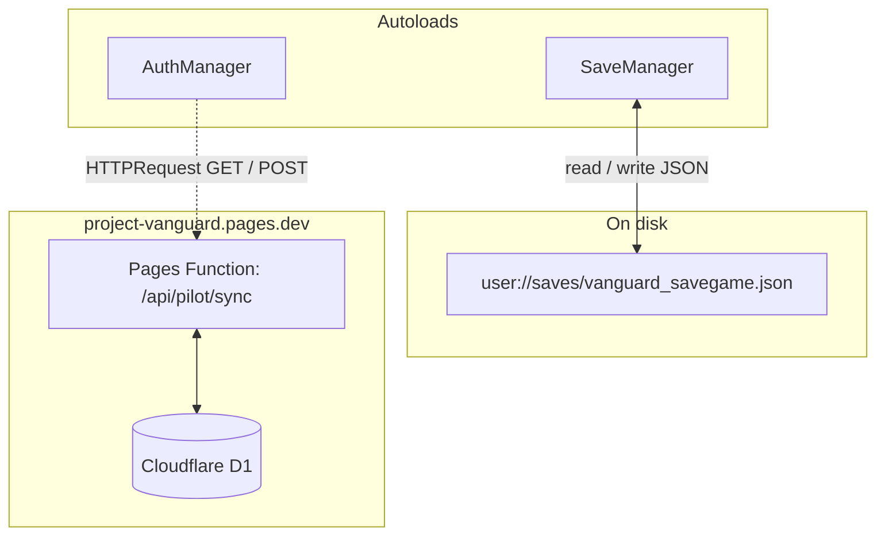

# Saves, Profiles and Cloud Sync

How the game saves locally, and how optional pilot accounts sync progress to
the website backend. The code is in
[`save_manager.gd`](../godot_project/save_manager.gd) (local saves) and
[`auth_manager.gd`](../godot_project/auth_manager.gd) (accounts and sync).

---

## 1. Where saves live

| | Path |
| :--- | :--- |
| Godot path | `user://saves/vanguard_savegame.json` (settings are separate, in `user://settings.cfg`) |
| Windows | `%APPDATA%\Godot\app_userdata\Project Vanguard\saves\vanguard_savegame.json` |
| Slot name | `vanguard_savegame` (the API takes a slot name, but the game only uses this one) |

Saves are indented JSON, so you can read and edit them by hand. They are not
signed or encrypted.

---

## 2. Save format

`format_version` is 1. `game_version` is taken from `project.godot`.

```json
{
  "format_version": 1,
  "game_version": "0.9.7",
  "timestamp": "2026-09-25T13:30:00",
  "display_date": "2026-09-25 13:30:00",
  "profile": {
    "callsign": "VANGUARD-LEAD",
    "squadron": "404th Vanguard Strike Wing",
    "rank": "LIEUTENANT"
  },
  "sortie": {
    "mission_id": "M01",
    "mission_title": "Operation CLOUDBURST",
    "theater": "Sub-Cloud Interception Sector 07",
    "scene_file": "res://main.tscn"
  },
  "campaign": { "...": "MissionManager.get_save_data()" },
  "ship": {
    "position": [0.0, 42.5, -80.0],
    "rotation": [0.0, 3.14159, 0.0],
    "current_speed": 140.0,
    "downward_velocity": 0.0
  },
  "telemetry": {
    "current_shield": 85.0,
    "current_hull": 100.0,
    "current_nitro": 92.4,
    "is_overheated": false,
    "overheat_timer": 0.0,
    "missiles_remaining": 3
  },
  "world": {
    "drone_alive": true,
    "drone_state": {
      "angle": 1.45,
      "health": 75.0,
      "global_pos": [-120.0, 75.0, -320.0]
    }
  }
}
```

---

## 3. Architecture



---

## 4. Accounts and cloud sync

The game works fully offline. An account is optional:

1. Register in game (login dialog) or on the website with a callsign,
   password and email.
2. Log in from the game. The server and the website's pilot page also
   support device link codes (`/api/auth/link`), but the game doesn't
   request one yet.
3. `AuthManager.sync_cloud_save()` POSTs stats and progress to
   `/api/pilot/sync`, and `GET /api/pilot/sync` pulls stats, Stars and rewards
   back down.

Passwords are hashed with PBKDF2-SHA256 (100,000 iterations) on the server. See
[ZERO_COST_INFRASTRUCTURE_AND_CONTROLLER_SPEC.md](ZERO_COST_INFRASTRUCTURE_AND_CONTROLLER_SPEC.md)
for the API and schema.

---

## 5. Menus

### Home menu (`home_menu.tscn`)
* If `SaveManager.has_save()` is true, it shows a **Continue** button and a
  summary of the save (date, hull, missiles).
* Otherwise it starts a new sortie.

### Pause menu (`pause_menu.tscn`, Esc)
* **Save Sortie** calls `SaveManager.save_game()` and shows a confirmation toast.
* **Load Last Save** calls `SaveManager.apply_save_to_current_scene()`, which
  restores position, speed, vitals and missiles, then unpauses.

---

## 6. Versioning

Releases follow [Semantic Versioning](https://semver.org/). The version appears
in several places, and a release bump should update all of them:

1. `VERSION`
2. `config/version` in `godot_project/project.godot`. The game reads it at
   runtime with `ProjectSettings.get_setting("application/config/version")`.
3. `application/version` and `short_version` for macOS in
   `godot_project/export_presets.cfg`
4. `website/package.json` and the version strings in `website/index.html`
5. `CHANGELOG.md`
