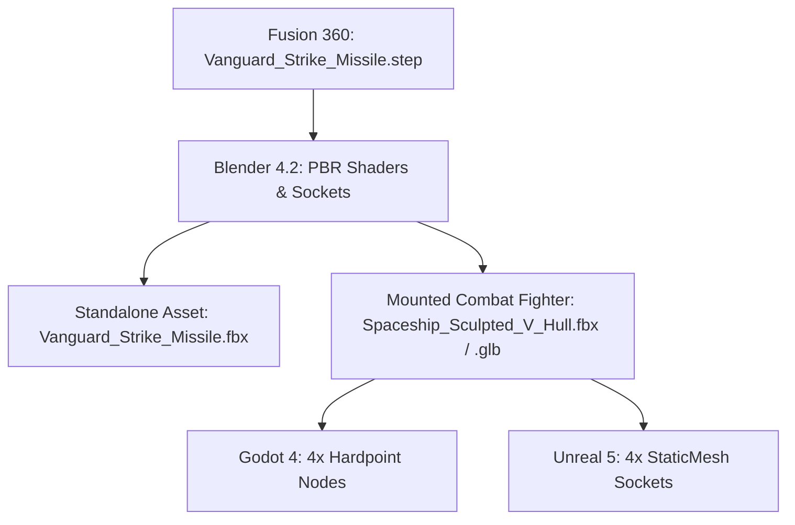

# Weapons and Hardpoints

## 1. Overview

Ordnance is modeled parametrically in Fusion 360, then given collision and sockets in Blender 4.2, and exported for Godot 4 and Unreal Engine 5.



---

## 2. Vanguard Precision Strike Missile Specifications

Generated by [`tools/generate_missile_fusion.py`](../tools/generate_missile_fusion.py):

| Dimension / Spec | Metric Measurement | Architectural Detail |
| :--- | :--- | :--- |
| **Total Length** | $2.35\text{ m}$ | |
| **Fuselage Diameter** | $0.18\text{ m}$ | Cylindrical body. |
| **Fin Span** | $0.53\text{ m}$ | Tip to tip, cruciform. |
| **Seeker Radome** | $0.48\text{ m}$ | Tangent ogive. |
| **Tail Fins** | 4, cruciform | 37 cm root chord. |
| **Canards** | 4, forward | Double-wedge profile. |
| **Exhaust Cavity** | $\varnothing 10.4\text{ cm} \times 14\text{ cm}$ deep | Where the exhaust particles are emitted. |

---

## 3. The Aerodynamic Wing Pylon (`Wing_Pylon_Mount`)

Each hardpoint has a pylon so the missiles don't float under the wing:
* **Dimensions:** Length $1.18\text{ m}$, Height $0.148\text{ m}$, Width $0.052\text{ m}$.
* **Leading Edge:** swept $45^\circ$.
* Sits flush against the underside of the wing.

---

## 4. Hardpoint Socket Layout

The fighter has 4 under-wing hardpoints. These are the socket positions in the Blender/UE5 asset (Blender axes):

```text
               [Cockpit]
                 /   \
        [L2]    /  |  \    [R2]
       [L1]    /   |   \    [R1]
       === Wing L === Wing R ===
```

* **Station 01 (Left Outer):** `(-3.60, -1.80, -0.25)` $\rightarrow$ `SOCKET_Weapon_Hardpoint_01`
* **Station 02 (Left Inner):** `(-2.60, -1.80, -0.25)` $\rightarrow$ `SOCKET_Weapon_Hardpoint_02`
* **Station 03 (Right Inner):** `(2.60, -1.80, -0.25)` $\rightarrow$ `SOCKET_Weapon_Hardpoint_03`
* **Station 04 (Right Outer):** `(3.60, -1.80, -0.25)` $\rightarrow$ `SOCKET_Weapon_Hardpoint_04`

---

## 5. Launching Missiles

### Godot
`spaceship_controller.gd` builds the hardpoints at runtime in
`_setup_weapon_hardpoints()` rather than reading the sockets from the mesh. The
positions are in Godot space:

| Station | Position |
| :--- | :--- |
| Left outer | `(-3.2, -0.22, 1.2)` |
| Left inner | `(-2.2, -0.26, 0.4)` |
| Right inner | `(2.2, -0.26, 0.4)` |
| Right outer | `(3.2, -0.22, 1.2)` |

Missiles are instances of `missile.tscn` (`missile.gd`). `LAUNCH_SEQUENCE`
fires left outer, right outer, left inner, then right inner to keep the load
balanced. The rack model on the firing station is hidden, and
`update_missile_racks()` shows it again as missiles reload.

### Unreal Engine 5
* `Get Socket Transform` on `SM_Spaceship_Sculpted_V_Hull` with socket
  `SOCKET_Weapon_Hardpoint_01` (to `_04`).
* `SpawnActorFromClass` (`BP_Vanguard_Strike_Missile`) at that transform.
* Attach the Niagara exhaust to `SOCKET_Missile_Exhaust`.
