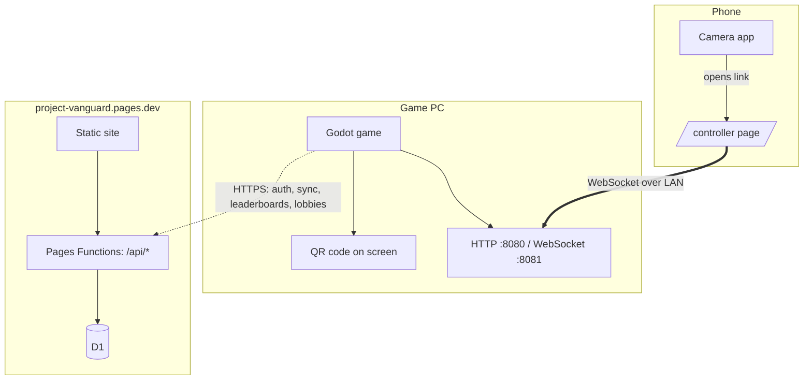

# Backend and Phone Controller

This doc covers two pieces:

1. **Backend:** accounts, cloud saves, leaderboards, lobbies and rewards on
   Cloudflare Pages Functions and D1. Everything fits in Cloudflare's free tier.
2. **Phone controller:** a web page that turns a phone into a gamepad. It's
   opened by scanning a QR code in the game, and nothing needs to be installed.

---

## 1. Topology



---

## 2. Backend

### 2.1 D1 schema

The source of truth is [`website/schema.sql`](../website/schema.sql). Tables:

| Table | Purpose |
| :--- | :--- |
| `pilots` | Accounts: callsign, email, PBKDF2 hash and salt, rank, squadron, email verification fields |
| `pilot_records` | Per-pilot totals (sorties, kills, flight time), highest unlocked mission, Stars, saved JSON blob |
| `device_links` | Pending and approved 6-character device link codes |
| `mission_leaderboards` | Submitted mission results (time, score, accuracy) |
| `active_sessions` | Presence heartbeats for the online and lobby counters |

`pilot_records.checksum_sha256` and `mission_leaderboards.ghost_r2_key` are
stored when the client sends them, but nothing checks them, and there is no R2
bucket.

### 2.2 Endpoints

All handlers are in [`website/functions/api/`](../website/functions/api/).
Shared helpers (PBKDF2 hashing, HMAC-signed tokens, CORS, D1 helpers) are in
the `_*.js` files.

| Path | Methods | Notes |
| :--- | :--- | :--- |
| `/api/auth/register` | POST | Creates a pilot and sends a verification email |
| `/api/auth/login` | POST | Returns a signed bearer token |
| `/api/auth/verify` | GET, POST | Verifies email by link token (GET) or 6-digit code (POST) |
| `/api/auth/resend-verification` | POST | 90 s cooldown |
| `/api/auth/link` | GET, POST | Device link codes: `?action=request`, `?action=approve`, poll with `?code=` |
| `/api/pilot/sync` | GET, POST | Pull and push stats, progress and the save blob (bearer token) |
| `/api/pilot/reward` | POST | `get_status`, `claim_streak`, `spin_wheel`, `buy_skin`, `equip_skin`, `buy_upgrade` |
| `/api/leaderboard` | GET, POST | `?type=` / `?mission=` / `?limit=` to read. POST submits a result |
| `/api/network/lobbies` | GET | Public P2P lobbies |
| `/api/network/heartbeat` | POST | Presence and lobby heartbeat. A session belongs to the IP that created it; other IPs get 409 until it expires (5 min). The pilot ID comes from the Bearer token, if sent |
| `/api/network/leave` | POST | `session_id` in the body or query. Only the owning IP can remove a session |
| `/api/network/stats` | GET | Online, lobby and registered counts |
| `/api/diag` | GET | Email and auth configuration check (`?test_to=` sends a test email). Needs `Authorization: Bearer <DIAG_TOKEN>`; returns 404 otherwise or when `DIAG_TOKEN` isn't set |

### 2.3 What's validated

* Passwords: PBKDF2-SHA256 with 100,000 iterations and a per-user salt.
* Tokens: HMAC-SHA256 signed with `AUTH_SECRET`, which must be a Pages
  secret of at least 32 characters. If it is missing, too short or the old
  published value, auth requests fail with a server error (500 or 503) that
  names the problem, rather than falling back to a default.
* Leaderboard submissions: score must be in `(0, 2,000,000]` and completion
  time at least 5 s. Anything else is taken on trust from the client, so treat
  the leaderboards as casual.

---

## 3. Phone Controller

### 3.1 How it connects

1. The game starts `network_controller_server.gd`, which runs an HTTP server
   on port 8080, which serves a bundled copy of the controller page, and a
   WebSocket server on port 8081.
2. The QR code holds a URL with the host's LAN IP, ports, the session's room
   code (`VNG-` plus 6 random characters), the player's callsign and the
   player slot.
3. The phone opens the page and connects straight to `ws://<host-ip>:8081`.
   Input never goes through Cloudflare.

The phone's first message must be a handshake whose `token` matches the room
code (case doesn't matter). Until then nothing it sends reaches a ship, and it
doesn't count as a connected controller. A wrong code closes the socket with
code 4001. No handshake within 5 seconds closes it with 4002. The phone shows
which one happened.

### 3.2 Browser APIs

* Touch events: stick, throttle and buttons
* `DeviceOrientationEvent`: gyro steering
* Vibration API: haptics on fire and on hits
* Screen Wake Lock: keeps the screen on
* WebSocket: input and telemetry

### 3.3 Phone → game (binary, about 30 Hz)

Each packet is 16 bytes, little-endian:

| Bytes | Type | Field |
| :--- | :--- | :--- |
| 0–3 | float32 | pitch, −1…1 |
| 4–7 | float32 | roll, −1…1 |
| 8–11 | float32 | throttle, 0…1 |
| 12–13 | int16 | yaw × 32767 |
| 14 | uint8 | flags: 1 = gun, 2 = boost, 4 = missile, bits 3–4 = power divert (0 balanced, 1 engines, 2 shields, 3 weapons), 32 = lock, 64 = re-centre |
| 15 | uint8 | sequence number |

### 3.4 Game → phone (JSON, 10 Hz)

```json
{
  "shield": 88.0,
  "hull": 100.0,
  "speed": 142.5,
  "missiles": 3,
  "target_locked": true,
  "under_fire": false,
  "power_mode": "BALANCED",
  "events": []
}
```

The phone vibrates on `under_fire`, on lock, and on queued combat events.

---

## 4. Files

* `website/functions/api/`: the API
* `website/controller.html`, `website/src/controller.js`: the controller page
  (`scripts/bundle-standalone-controller.js` builds the single-file copy the
  game serves)
* `godot_project/network_controller_server.gd`: HTTP and WebSocket server, and
  input routing to `SpaceshipController`
* `godot_project/qr_code.gd`, `qr_join_dialog.tscn`: QR generation and the
  pairing dialog
